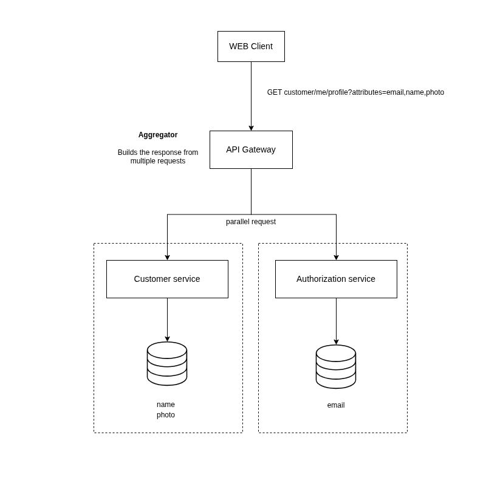

# API Gateway as an aggregation service

## Context
[Describe the context of the issue, challenge or feature]
The Api Gateway exposes the only interface to which clients might interact with the system, the gateway is then resposible to interact with these back-end services and, quite often, 

Different aspects of the same entity live in different services/domains. For example, let's consider a Customer Entity on the system that has these properties:

Customer service domain:
* First name
* Last name
* Profile picture
* Date of birth

Authorization service domain:
* Email
* Password

To get a certain data view that includes information from both services I need a tool to orchestrate mutiple requests and then return a single json to the client.

## Options considered
* Create a dedicated aggregate service that orchestrates multiservice requests. 
* Let the gateway assume the composition responsability.

## Decision
For my current needs I'll assign the api aggretation responsability to the gateway itself. So, it have two responsabilities: redirect requests and orchestrate calls to multiple services.

The reason here is because at this stage the APIs are relatively simple, involving requests to few services. I already have a container for the gateway running and it already has access to these services, so for me it makes sense to increase its responsabilities without relying on a brand new service. 

Also, api gateway already has a resource server, which allows me to validate credentials without extra setup.

The following image demonstrates how this composition might work using the scenario described in the [context section](#context):

 

## Consequences
* From the client's perspective these implementatios are abstracted away, so in the future I can implement a dedicated aggregator and not changing the exposed api.
* Spring's Cloud Gateway already has handlers and supports this type of use case.
* Before, the api gateway was being used as a simple proxy server, but now the gateway must own logic that knows about specific details of services it wants to query and aggregate from, which might increase coupling between them.
* Implement an aggregator service would require substantion changes inside the gateway, but should not affect other back-end services neither the client.